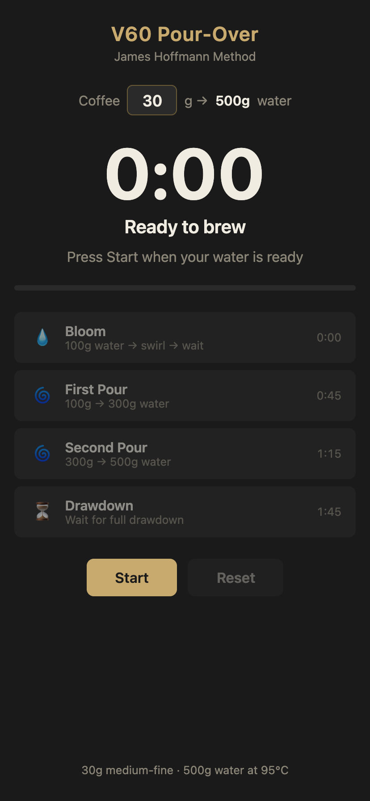
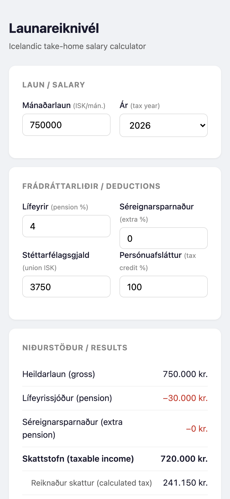
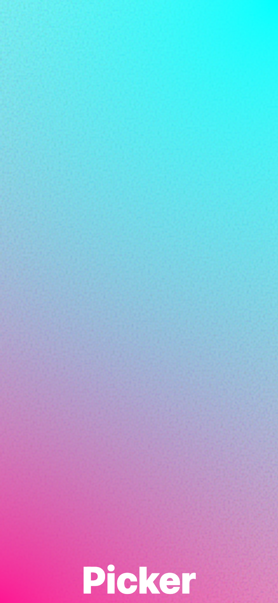

<h1>Projects</h1>

Small apps and pages I've made and still maintain.

<h2><a href="https://v60.koddsson.com">v60.koddsson.com</a></h2>

A timer and guide for brewing pour-over coffee using the James Hoffmann V60 method.

<h2><a href="https://skattur.koddsson.com">skattur.koddsson.com</a></h2>

An Icelandic salary calculator that shows take-home pay after taxes, pension, and deductions.

<h2><a href="https://koddsson.github.io/picker/">Picker</a></h2>

Put your fingers on the screen and it picks one. Great for settling debates.

